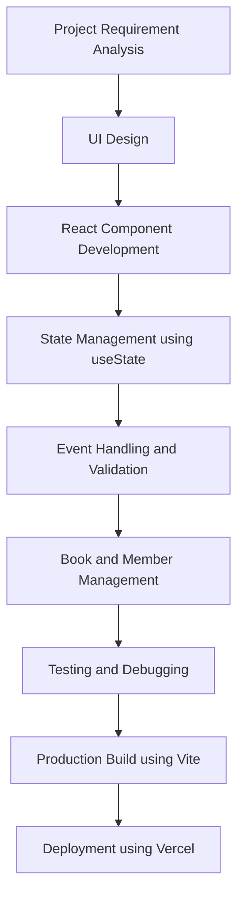
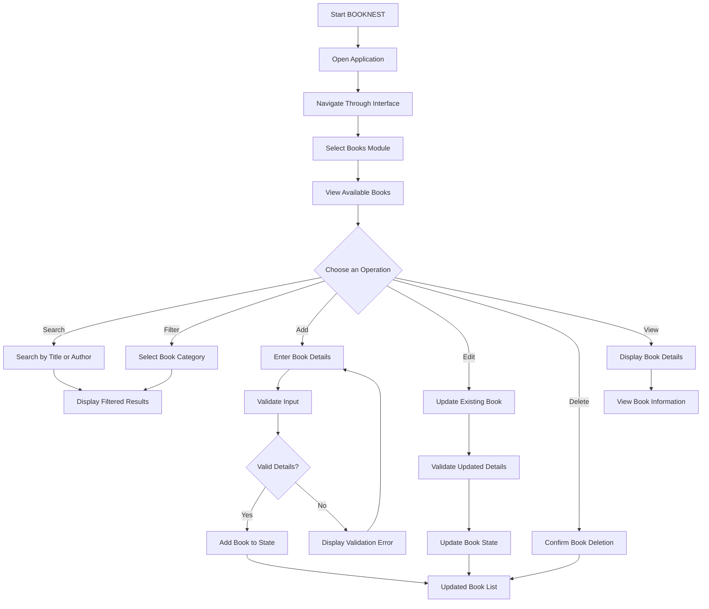

# BOOKNEST – Library Management System

## 1. Project Overview

BOOKNEST is a web-based Library Management System developed using React.js. It provides a user-friendly interface to manage library books and members. The application simplifies book management through features such as adding, viewing, searching, filtering, editing, and deleting book records.

## 2. Problem Statement

### Existing System Challenges

Traditional library management systems often depend on manual registers or basic record-keeping methods. These approaches can create several difficulties:

- **Manual Record Maintenance:** Maintaining book and member information manually is time-consuming.
- **Difficult Book Searching:** Finding a particular book can take more time when records are maintained manually.
- **Data Management Issues:** Updating and maintaining records can become difficult as the number of books increases.
- **Human Errors:** Manual data entry may result in duplicate or incorrect information.
- **Limited Accessibility:** Traditional systems may not provide a convenient and user-friendly interface for managing library information.

## 3. Proposed Solution

BOOKNEST provides a web-based interface to simplify library management activities.

The proposed system offers:

- Digital book record management.
- Search functionality to find books by title or author.
- Category-based book filtering.
- Add, edit, view, and delete operations.
- Input validation to reduce incorrect and duplicate book entries.
- Member management interface.
- A clean and responsive user interface for easier navigation.

The application currently uses React state to manage book records. Database integration and permanent data storage can be introduced in future development.

## 4. Technologies Used

| Technology | Purpose |
|---|---|
| HTML5 | Defines the structure of web pages. |
| CSS3 | Provides styling, layouts, colors, and responsive design. |
| JavaScript ES6 | Implements application logic, event handling, filtering, and validation. |
| React.js | Builds reusable and interactive user interface components. |
| React Hooks (`useState`) | Manages component state and dynamic data. |
| Bootstrap Icons | Provides icons for buttons and interface elements. |
| Vite | Provides the development server and production build process. |
| Git | Tracks source code changes and versions. |
| GitHub | Hosts the project source code. |
| Vercel | Deploys and hosts the application online. |

## 5. Important Code Implementation and Purpose

| Important Code | Purpose |
|---|---|
| `import { useState } from "react";` | Imports the React Hook for state management. |
| `useState(initialBooks)` | Initializes the book list with predefined book records. |
| `setBooks()` | Updates the book list whenever records are added, edited, or deleted. |
| `books.filter()` | Filters books based on search text and selected category. |
| `books.map()` | Dynamically displays book records as cards. |
| `books.some()` | Checks whether a book with a duplicate title or ISBN already exists. |
| `Date.now()` | Generates an ID for a newly added book. |
| `validateBook()` | Validates book details before adding or updating a record. |
| `setBooks(prev => [...prev, newBook])` | Adds a new book without directly modifying the existing array. |
| `setBooks(prev => prev.filter(book => book.id !== id))` | Removes a book based on its ID. |
| `setBooks(prev => prev.map(...))` | Updates the details of an existing book. |
| `{showForm && (...)}` | Conditionally displays the Add Book form. |
| `{selectedBook && (...)}` | Displays the selected book's detailed information. |
| `window.confirm()` | Requests confirmation before deleting a book. |

## 6. Approach Diagram

The project follows a component-based frontend development approach.



## 7. Project Workflow Diagram



## 8. Features Developed

### Book Management

- Display predefined book records.
- Add new books with relevant information.
- Edit existing book details.
- Delete books with confirmation.
- View complete book information.

### Search and Filtering

- Search books using title and author.
- Filter books based on categories.
- Clear search input and filters.
- Display matching book records dynamically.

### Form Validation

- Validate mandatory fields.
- Validate publication year.
- Validate ISBN format.
- Check for duplicate book titles and ISBN values.
- Validate positive page numbers.
- Validate image URL format.

### User Interface

- Responsive navigation interface.
- Book cards with images and details.
- Interactive forms and buttons.
- Bootstrap icons.
- Book details modal.
- Error handling for unavailable book images.

### Member Management

- Provides a member management interface for handling library member information.

## 9. Future Scope

The following enhancements can be implemented in future versions:

1. **Backend Integration:** Integrate Python Flask or Node.js to handle server-side operations.
2. **Database Integration:** Use MySQL or MongoDB for permanent storage of book and member records.
3. **Authentication and Authorization:** Implement secure login and role-based access for administrators and members.
4. **Book Issue and Return:** Develop functionality to issue books and manage return dates.
5. **Fine Calculation:** Automatically calculate late-return fines.
6. **Book Availability Tracking:** Display available and issued book quantities.
7. **Email Notifications:** Send notifications for due dates and overdue books.
8. **Report Generation:** Generate reports for book inventory, members, and borrowing activities.

## 10. Project Architecture

BOOKNEST currently follows a frontend-based React architecture.

```text
BOOKNEST
│
├── public/
│
├── src/
│   ├── components/
│   │   ├── Navbar.jsx
│   │   └── ...
│   │
│   ├── pages/
│   │   ├── Books.jsx
│   │   ├── Members.jsx
│   │   └── ...
│   │
│   ├── App.jsx
│   ├── main.jsx
│   └── style.css
│
├── index.html
├── package.json
├── package-lock.json
└── vite.config.js
```

*Note: Update the folder and file names above to match your actual project structure.*

## 11. Installation and Execution

### Prerequisites

- Node.js
- npm
- Visual Studio Code

### Steps to Run the Project

**1. Clone the repository**

```bash
git clone YOUR_GITHUB_REPOSITORY_URL
```

**2. Navigate to the project folder**

```bash
cd lms-project
```

**3. Install dependencies**

```bash
npm install
```

**4. Start the development server**

```bash
npm run dev
```

**5. Open the local URL displayed in the terminal.**

### Production Build

```bash
npm run build
```

## 12. Deployment

The application is deployed using Vercel.

- **Live Demo:** https://lms-project-zeta-rouge.vercel.app/
- **GitHub Repository:** https://github.com/lalithya2910/lms-project

## 13. Conclusion

BOOKNEST demonstrates how React.js can be used to develop an interactive and user-friendly Library Management System. It simplifies book record management through dynamic rendering, state management, search, filtering, and form validation. The project can be further enhanced with backend integration, database connectivity, and automated library operations.

# React + Vite

This template provides a minimal setup to get React working in Vite with HMR and some ESLint rules.

Currently, two official plugins are available:

- [@vitejs/plugin-react](https://github.com/vitejs/vite-plugin-react/blob/main/packages/plugin-react) uses [Oxc](https://oxc.rs)
- [@vitejs/plugin-react-swc](https://github.com/vitejs/vite-plugin-react/blob/main/packages/plugin-react-swc) uses [SWC](https://swc.rs/)

## React Compiler

The React Compiler is not enabled on this template because of its impact on dev & build performances. To add it, see [this documentation](https://react.dev/learn/react-compiler/installation).

## Expanding the ESLint configuration

If you are developing a production application, we recommend using TypeScript with type-aware lint rules enabled. Check out the [TS template](https://github.com/vitejs/vite/tree/main/packages/create-vite/template-react-ts) for information on how to integrate TypeScript and [`typescript-eslint`](https://typescript-eslint.io) in your project.
