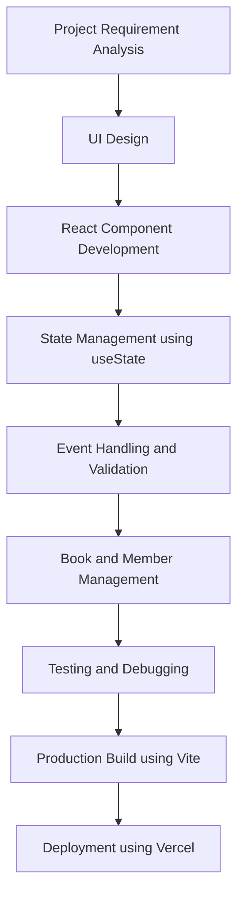
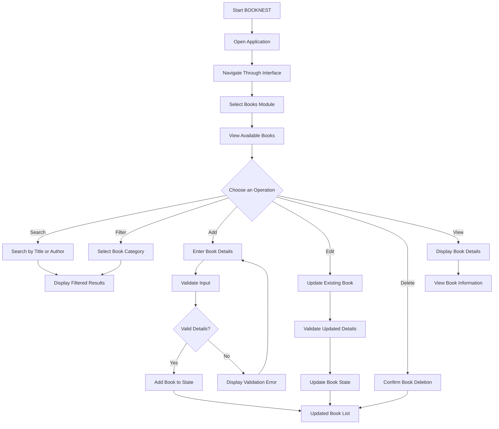

# BOOKNEST – Library Management System

## 1. Project Overview

BOOKNEST is a web-based Library Management System developed using React.js. It provides a user-friendly interface to manage library books and members. The application simplifies book management through features such as adding, viewing, searching, filtering, editing, and deleting book records.

## 2. Problem Statement

### Existing System Challenges

Traditional library management systems often depend on manual registers or basic record-keeping methods. These approaches can create several difficulties:

- **Manual Record Maintenance:** Maintaining book and member information manually is time-consuming.
- **Difficult Book Searching:** Finding a particular book can take more time when records are maintained manually.
- **Data Management Issues:** Updating and maintaining records can become difficult as the number of books increases.
- **Human Errors:** Manual data entry may result in duplicate or incorrect information.
- **Limited Accessibility:** Traditional systems may not provide a convenient and user-friendly interface for managing library information.

## 3. Proposed Solution

BOOKNEST provides a web-based interface to simplify library management activities.

The proposed system offers:

- Digital book record management.
- Search functionality to find books by title or author.
- Category-based book filtering.
- Add, edit, view, and delete operations.
- Input validation to reduce incorrect and duplicate book entries.
- Member management interface.
- A clean and responsive user interface for easier navigation.

The application currently uses React state to manage book records. Database integration and permanent data storage can be introduced in future development.

## 4. Technologies Used

| Technology | Purpose |
|---|---|
| HTML5 | Defines the structure of web pages. |
| CSS3 | Provides styling, layouts, colors, and responsive design. |
| JavaScript ES6 | Implements application logic, event handling, filtering, and validation. |
| React.js | Builds reusable and interactive user interface components. |
| React Hooks (`useState`) | Manages component state and dynamic data. |
| Bootstrap Icons | Provides icons for buttons and interface elements. |
| Vite | Provides the development server and production build process. |
| Git | Tracks source code changes and versions. |
| GitHub | Hosts the project source code. |
| Vercel | Deploys and hosts the application online. |


## 📦 Imports and Their Uses

The following table describes commonly used imports in the BOOKNEST React application.

| Import Statement | Purpose |
|---|---|
| `import React from "react"` | Imports the React library for building UI components. |
| `import { useState } from "react"` | Manages component state and updates UI dynamically. |
| `import { useEffect } from "react"` | Handles side effects such as loading data when a component renders. |
| `import { useNavigate } from "react-router-dom"` | Navigates programmatically between application pages. |
| `import { Link } from "react-router-dom"` | Navigates between routes without reloading the entire page. |
| `import { NavLink } from "react-router-dom"` | Creates navigation links with active-route styling. |
| `import { Routes, Route } from "react-router-dom"` | Defines application routes and maps them to components. |
| `import { BrowserRouter } from "react-router-dom"` | Enables client-side routing in the application. |
| `import "./App.css"` | Imports CSS styles for the application. |
| `import "./index.css"` | Imports global styles. |
| `import { useParams } from "react-router-dom"` | Retrieves dynamic parameters from the URL. |
| `import { useLocation } from "react-router-dom"` | Accesses information about the current URL and route. |

*Note: These are common React imports. Keep only the imports that are actually used in your project.*

## 💻 JavaScript Code and Their Uses

The following table explains important JavaScript functions, methods, and syntax used in frontend application development.

| JavaScript Code | Purpose |
|---|---|
| `const` | Declares variables that cannot be reassigned. |
| `let` | Declares variables whose values can be reassigned. |
| `function` | Defines reusable blocks of code. |
| `return` | Returns a value or JSX from a function or component. |
| `import` | Imports modules, functions, and components from other files. |
| `export` | Makes functions and components available to other files. |
| `map()` | Iterates through an array and generates elements for each item. |
| `filter()` | Filters array elements based on specified conditions. |
| `find()` | Returns the first element that matches a condition. |
| `forEach()` | Executes a function for each element in an array. |
| `push()` | Adds a new element to an array. |
| `splice()` | Adds, removes, or replaces array elements. |
| `slice()` | Extracts a portion of an array without modifying the original. |
| `includes()` | Checks whether an array or string contains a particular value. |
| `length` | Returns the number of elements in an array or characters in a string. |
| `charAt()` | Returns a character at a specified index. |
| `toUpperCase()` | Converts a string into uppercase letters. |
| `toLowerCase()` | Converts a string into lowercase letters. |
| `trim()` | Removes whitespace from the beginning and end of a string. |
| `JSON.stringify()` | Converts JavaScript objects into JSON strings. |
| `JSON.parse()` | Converts JSON strings into JavaScript objects. |
| `localStorage.setItem()` | Stores data in browser local storage. |
| `localStorage.getItem()` | Retrieves stored data from browser local storage. |
| `localStorage.removeItem()` | Removes a specific item from local storage. |
| `async` | Defines an asynchronous function. |
| `await` | Waits for an asynchronous operation to complete. |
| `fetch()` | Sends HTTP requests to APIs or servers. |
| `try...catch` | Handles runtime errors and exceptions. |
| `preventDefault()` | Prevents the browser's default event behavior. |
| `setTimeout()` | Executes a function after a specified time delay. |
| `new Date()` | Creates a date object to work with dates and times. |

## ⚛️ React Hooks and Their Uses

React Hooks allow functional components to manage state and perform additional operations.

| React Hook | Purpose |
|---|---|
| `useState()` | Manages dynamic data within a component. |
| `useEffect()` | Performs side effects such as data fetching and event handling. |
| `useNavigate()` | Programmatically navigates between application routes. |
| `useParams()` | Retrieves dynamic route parameters. |
| `useLocation()` | Provides information about the current route. |
| `useRef()` | Maintains a mutable reference without triggering re-renders. |
| `useContext()` | Shares data between components without passing props through every level. |
| `useMemo()` | Memoizes calculated values to avoid unnecessary recalculations. |
| `useCallback()` | Memoizes functions between renders. |

## 🔄 JavaScript Operators and Their Uses

| Operator | Purpose |
|---|---|
| `=` | Assigns a value to a variable. |
| `==` | Compares two values with type conversion. |
| `===` | Compares two values and their data types. |
| `!=` | Checks whether two values are unequal. |
| `!==` | Checks whether two values or types are different. |
| `&&` | Logical AND operator. |
| `\|\|` | Logical OR operator. |
| `!` | Logical NOT operator. |
| `? :` | Ternary operator for conditional expressions. |
| `...` | Spread syntax for copying or expanding arrays and objects. |
| `?.` | Optional chaining for safe property access. |
| `??` | Provides a fallback value when a value is null or undefined. |
| `=>` | Defines an arrow function. |


## 6. Approach Diagram

The project follows a component-based frontend development approach.



## 6. Approach Diagram – Explanation

The approach diagram represents the complete development lifecycle of the BOOKNEST Library Management System. It explains how the project was planned, designed, implemented, tested, and deployed using modern frontend technologies.

### 1. Project Requirement Analysis

Initially, the functional requirements of the Library Management System were identified. This involved understanding the problems in traditional library management and defining the required features, such as book management, member management, searching, filtering, and record updates.

### 2. UI Design

Based on the identified requirements, the application's user interface was designed using HTML5 and CSS3. The focus was on creating a clean, responsive, and user-friendly interface that allows users to navigate between different modules easily.

### 3. React Component Development

React.js was used to develop the application. The interface was divided into individual reusable components, such as navigation, book cards, forms, and member-related sections. This component-based architecture makes the code easier to maintain and update.

### 4. State Management using useState

React's `useState` Hook was implemented to manage dynamic application data. For example, in the Books module, it manages the book list, search input, selected category, form information, and selected book details. Whenever the state changes, React updates the corresponding UI.

### 5. Event Handling and Validation

Event handlers were implemented to process user interactions such as adding, editing, deleting, and searching for books. Client-side validation was also introduced to check mandatory fields, ISBN format, publication year, page numbers, and duplicate records before accepting book information.

### 6. Book and Member Management

The core library management functionalities were implemented in this phase. The Books module supports CRUD operations (Create, Read, Update, and Delete), search functionality, category-based filtering, and viewing complete book details. The Members module provides an interface for managing library member information.

### 7. Testing and Debugging

After implementation, the application was tested to verify that individual features and user interactions worked as expected. Errors in form validation, search functionality, filtering, and record management were identified and corrected.

### 8. Production Build using Vite

Once development and testing were completed, Vite was used to generate the production build. It bundles the application resources and prepares optimized files that can be hosted on a deployment platform.

### 9. Deployment using Vercel

Finally, the production build was deployed on Vercel. This makes the BOOKNEST application accessible online through a public URL without requiring users to run the project locally.

### Overall Development Approach

The development process begins with requirement identification and interface design, followed by React component implementation and state management. Next, user interactions and validation are integrated to implement the library management functionalities. After functional testing and debugging, Vite generates the production build, which is deployed through Vercel.

**This structured approach helps achieve modular development, reusable components, efficient state management, improved maintainability, and successful application deployment.**


## 7. Project Workflow Diagram



## 8. Features Developed

### Book Management

- Display predefined book records.
- Add new books with relevant information.
- Edit existing book details.
- Delete books with confirmation.
- View complete book information.

### Search and Filtering

- Search books using title and author.
- Filter books based on categories.
- Clear search input and filters.
- Display matching book records dynamically.

### Form Validation

- Validate mandatory fields.
- Validate publication year.
- Validate ISBN format.
- Check for duplicate book titles and ISBN values.
- Validate positive page numbers.
- Validate image URL format.

### User Interface

- Responsive navigation interface.
- Book cards with images and details.
- Interactive forms and buttons.
- Bootstrap icons.
- Book details modal.
- Error handling for unavailable book images.

### Member Management

- Provides a member management interface for handling library member information.

## 9. Future Scope

The following enhancements can be implemented in future versions:

1. **Backend Integration:** Integrate Python Flask or Node.js to handle server-side operations.
2. **Database Integration:** Use MySQL or MongoDB for permanent storage of book and member records.
3. **Authentication and Authorization:** Implement secure login and role-based access for administrators and members.
4. **Book Issue and Return:** Develop functionality to issue books and manage return dates.
5. **Fine Calculation:** Automatically calculate late-return fines.
6. **Book Availability Tracking:** Display available and issued book quantities.
7. **Email Notifications:** Send notifications for due dates and overdue books.
8. **Report Generation:** Generate reports for book inventory, members, and borrowing activities.

## 10. Project Architecture

BOOKNEST currently follows a frontend-based React architecture.

```text
BOOKNEST
│
├── public/
│
├── src/
│   ├── components/
│   │   ├── Navbar.jsx
│   │   └── ...
│   │
│   ├── pages/
│   │   ├── Books.jsx
│   │   ├── Members.jsx
│   │   └── ...
│   │
│   ├── App.jsx
│   ├── main.jsx
│   └── style.css
│
├── index.html
├── package.json
├── package-lock.json
└── vite.config.js
```

*Note: Update the folder and file names above to match your actual project structure.*

## 11. Installation and Execution

### Prerequisites

- Node.js
- npm
- Visual Studio Code

### Steps to Run the Project

**1. Clone the repository**

```bash
git clone YOUR_GITHUB_REPOSITORY_URL
```

**2. Navigate to the project folder**

```bash
cd lms-project
```

**3. Install dependencies**

```bash
npm install
```

**4. Start the development server**

```bash
npm run dev
```

**5. Open the local URL displayed in the terminal.**

### Production Build

```bash
npm run build
```

## 12. Deployment

The application is deployed using Vercel.

- **Live Demo:** https://lms-project-zeta-rouge.vercel.app/
- **GitHub Repository:** https://github.com/lalithya2910/lms-project

## 13. Conclusion

BOOKNEST demonstrates how React.js can be used to develop an interactive and user-friendly Library Management System. It simplifies book record management through dynamic rendering, state management, search, filtering, and form validation. The project can be further enhanced with backend integration, database connectivity, and automated library operations.

# React + Vite

This template provides a minimal setup to get React working in Vite with HMR and some ESLint rules.

Currently, two official plugins are available:

- [@vitejs/plugin-react](https://github.com/vitejs/vite-plugin-react/blob/main/packages/plugin-react) uses [Oxc](https://oxc.rs)
- [@vitejs/plugin-react-swc](https://github.com/vitejs/vite-plugin-react/blob/main/packages/plugin-react-swc) uses [SWC](https://swc.rs/)

## React Compiler

The React Compiler is not enabled on this template because of its impact on dev & build performances. To add it, see [this documentation](https://react.dev/learn/react-compiler/installation).

## Expanding the ESLint configuration

If you are developing a production application, we recommend using TypeScript with type-aware lint rules enabled. Check out the [TS template](https://github.com/vitejs/vite/tree/main/packages/create-vite/template-react-ts) for information on how to integrate TypeScript and [`typescript-eslint`](https://typescript-eslint.io) in your project.
